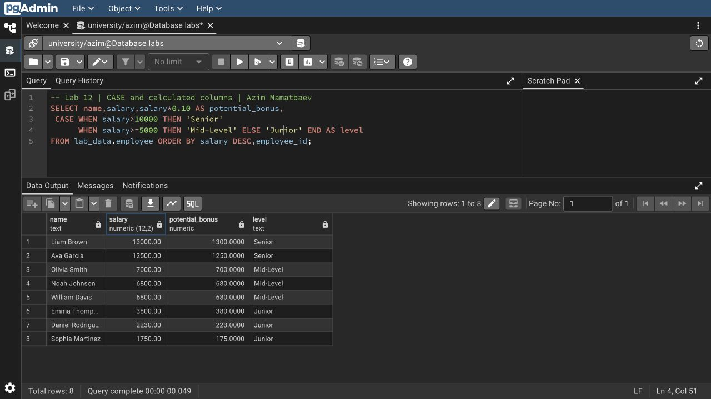
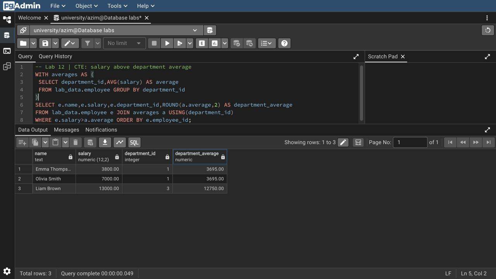

# Азим Маматбаев

## Лабораторная работа 12 — Querying Data

Я выполнил все виды запросов из материала: `SELECT`, вычисляемые столбцы и `AS`, сравнения, `AND/OR/NOT`, `BETWEEN`, проверки `NULL`, `LIKE/ILIKE`, четыре оператора регулярных выражений, `IN`, `EXISTS`, `CASE` и CTE.

В примерах из Drive нет полного набора записей для `employees` и других таблиц. Для выполнения я взял опубликованные учебные данные DataLemur, который рекомендован в материале. Источники и точный объём записей указаны в [DATA.md](DATA.md). Запросы адаптированы к этим столбцам. Например, CTE нашёл Emma Thompson, Olivia Smith и Liam Brown с зарплатой выше средней по своему отделу.

[Подготовка данных](source-data.sql) · [SQL запросов](lab12.sql) · [Полный вывод](result.txt) · [Запросы со скриншотов](screenshots.sql)

[Исходный материал из Drive](https://docs.google.com/document/d/1-cihprgNppU8XEBNQh3kplBKjd1-9UPL/edit)
