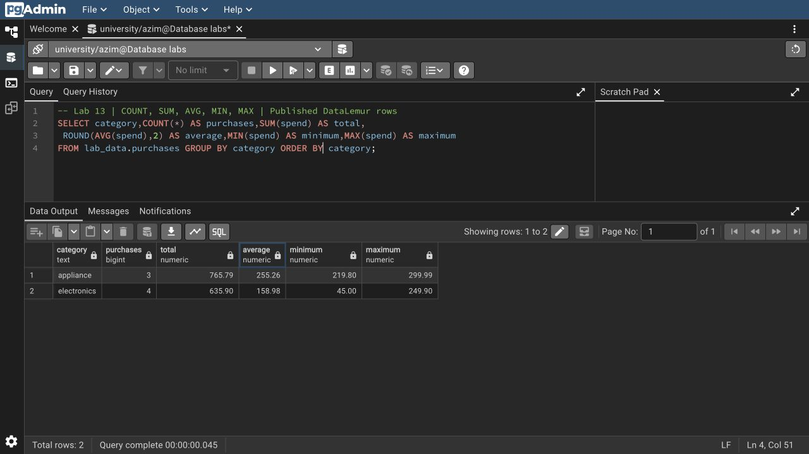
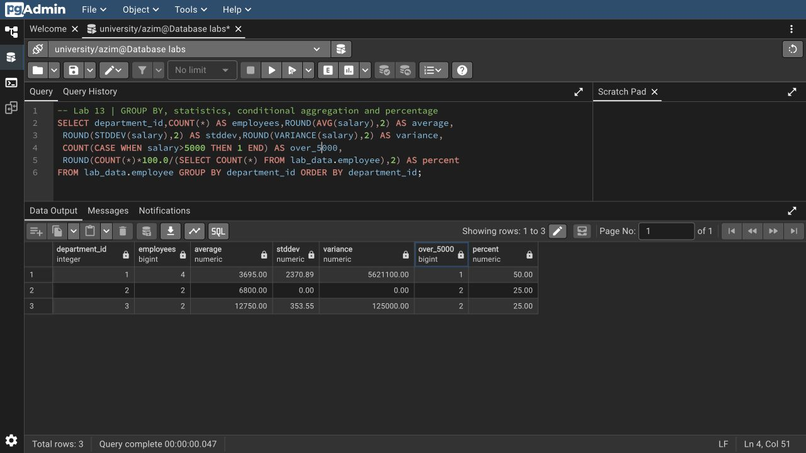

# Азим Маматбаев

## Лабораторная работа 13 — Aggregate Functions

Я посчитал `COUNT`, `SUM`, `AVG`, `MIN/MAX`, списки `STRING_AGG`, массивы `ARRAY_AGG`, `STDDEV`, `VARIANCE` и `CORR`. Проверил группировку по нескольким столбцам и выражению, `HAVING`, условные агрегаты, долю группы в процентах и различие обычного агрегата с оконной функцией. Отдельно сравнил `COUNT(*)` с `COUNT(manager_id)` и обработку `NULL`.

В опубликованном подмножестве 8 сотрудников и 7 покупок. Общая сумма покупок — 1401.69: appliances — 765.79, electronics — 635.90. В отделах 4, 2 и 2 сотрудника, то есть 50%, 25% и 25%. Все запросы выполнены на тех же [исходных данных](../week10/DATA.md), без добавления выдуманных записей.

[SQL](lab13.sql) · [Полный вывод](result.txt) · [Запросы со скриншотов](screenshots.sql)

[Исходный материал из Drive](https://docs.google.com/document/d/1CU4xZzAL52Sm0nzcEufCutvlu2C2Z2Yi/edit)
