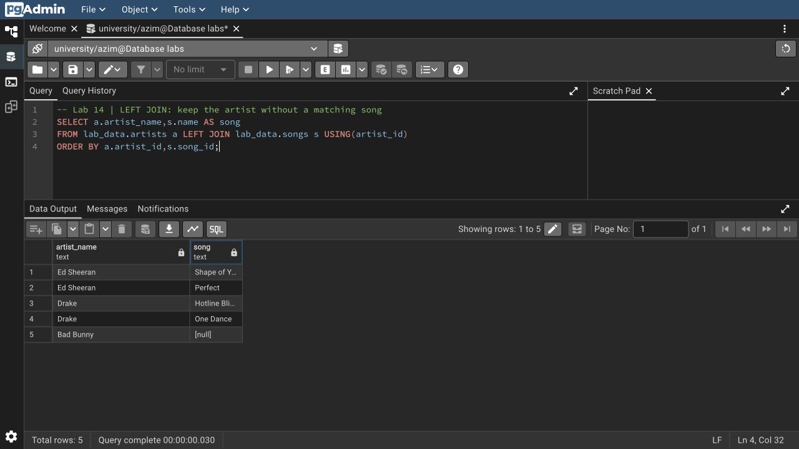
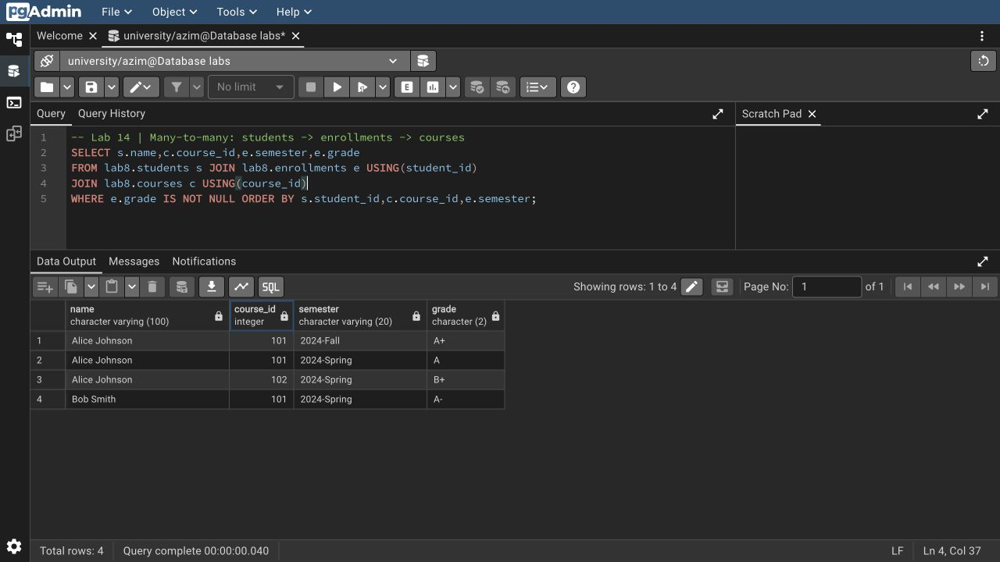

# Азим Маматбаев

## Лабораторная работа 14 — Joining Tables

Я выполнил `INNER`, `LEFT`, `RIGHT`, `FULL OUTER` и `CROSS JOIN`, соединение трёх таблиц, self join сотрудников с руководителями, условное соединение и anti-join через `IS NULL`. Проверил one-to-one, one-to-many и many-to-many через связующую таблицу. Добавил индексы на столбцы соединений и сравнил правильный JOIN с декартовым произведением.

В исходных данных 3 артиста и 4 песни: `INNER JOIN` вернул 4 строки, внешние соединения — 5, сохранив Bad Bunny без песни. Декартово произведение дало 12 строк. В связи студентов с курсами получилось 4 записи. Дополнительно решил рекомендованный пример DataLemur: Olivia Smith зарабатывает больше своего руководителя.

[SQL](lab14.sql) · [Полный вывод](result.txt) · [Происхождение данных](../week10/DATA.md) · [Запросы со скриншотов](screenshots.sql)

[Исходный материал из Drive](https://docs.google.com/document/d/1LxE7hZ0vhc3xIfryMtvSnM64u8A0xoH0/edit)
