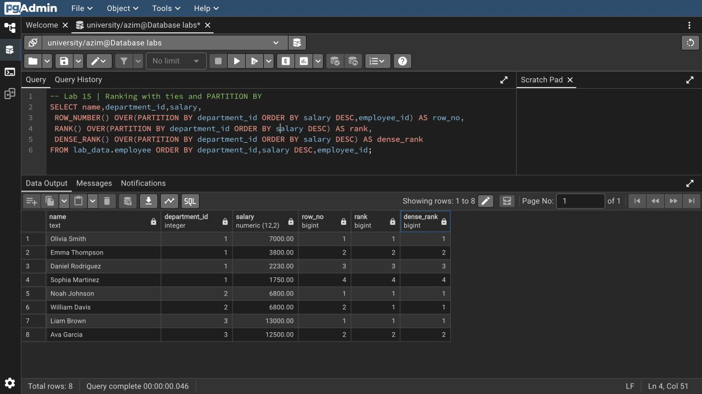
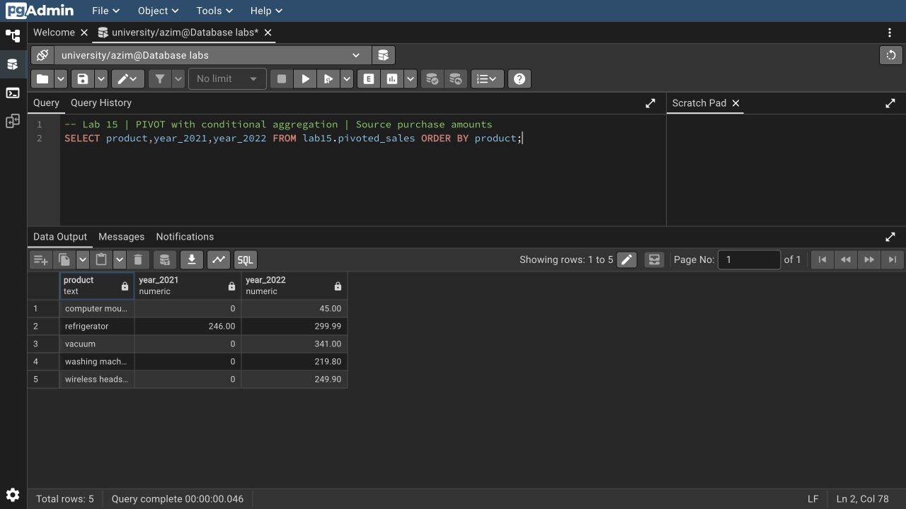

# Азим Маматбаев

## Лабораторная работа 15 — Advanced Querying

Я выполнил скалярный, строковый и табличный подзапросы, обычный и рекурсивный CTE, `UNION/UNION ALL`, `INTERSECT`, `EXCEPT`, оконные `ROW_NUMBER`, `RANK`, `DENSE_RANK`, `SUM/AVG`, `LAG/LEAD`. Также сделал PIVOT условной агрегацией, обратный UNPIVOT через `UNION ALL`, `FILTER`, сортировку через `CASE`, `EXPLAIN` и `EXPLAIN ANALYZE`.

Рекурсивный запрос вернул 6 сотрудников, связанных с тремя корневыми руководителями. Ещё у двух сотрудников руководители отсутствуют в опубликованном примере — их я вывел отдельно. PIVOT сохранил покупки 2021 и 2022 годов. Одинаковые зарплаты в отделе 2 получили одинаковый `RANK`, но разные `ROW_NUMBER`.

После создания индекса PostgreSQL выбрал последовательное чтение маленькой таблицы из 8 строк. План и реальное время сохранены в выводе; ускорение от индекса на таком объёме я не утверждаю.

[SQL](lab15.sql) · [Полный вывод](result.txt) · [Исходные данные](../week10/DATA.md) · [Запросы со скриншотов](screenshots.sql)

[Исходный материал из Drive](https://docs.google.com/document/d/1gU37bli-KJzA6MgdamHLFV24tYdpaHL8/edit)
