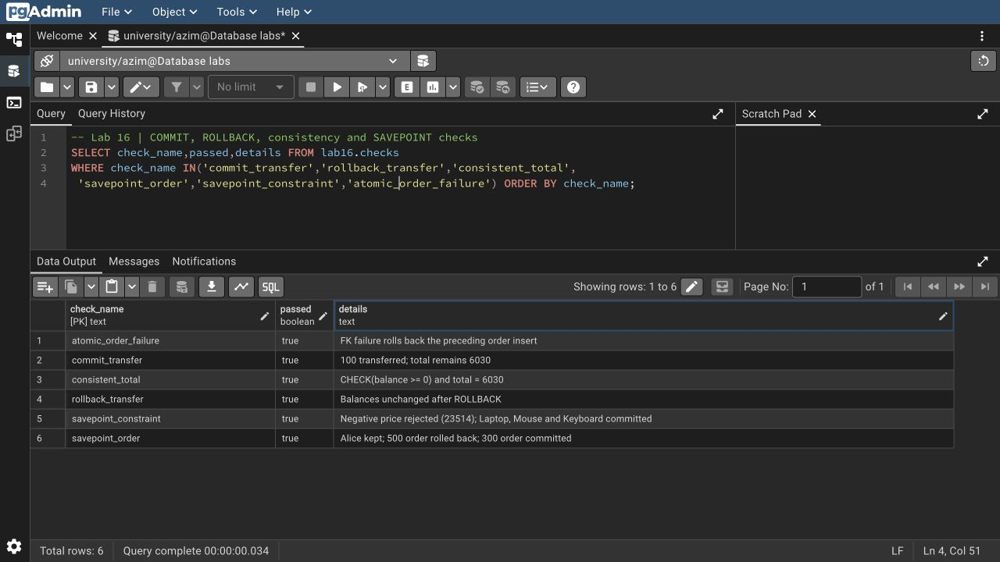
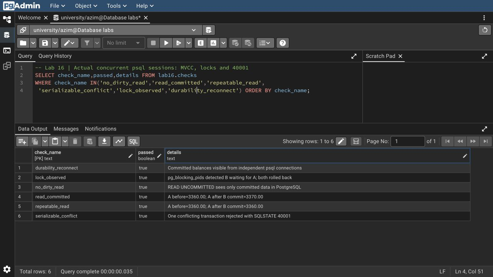

# Азим Маматбаев

## Лабораторная работа 16 — Transactions and ACID Properties

Я проверил `BEGIN/COMMIT/ROLLBACK`, атомарность нескольких операций, ограничения, `SAVEPOINT`, `ROLLBACK TO`, `RELEASE SAVEPOINT`, уровни изоляции и блокировки. В учебные счета скопировал суммы 3800 и 2230 из опубликованных зарплат сотрудников 1 и 2; это не реальные банковские счета. Названия и цены товаров взяты из Lab 16.

Перевод 100 сохранился, следующий перевод откатился, затем сохранился перевод 500. После начисления 5% остатки составили 3360.00 и 2971.50. Отрицательная цена вызвала ожидаемую ошибку `23514`; после возврата к savepoint сохранились три допустимых товара. Ошибка внешнего ключа откатила заказ целиком.

Для проверки изоляции запустил несколько настоящих подключений `psql`. При `READ COMMITTED` повторное чтение увидело 3370.00 после изменения другим соединением, а `REPEATABLE READ` сохранил 3360.00. Конфликт `SERIALIZABLE` завершился ожидаемым `40001`. Через `pg_blocking_pids` увидел реальное ожидание блокировки. Все 13 проверок получили `true`.

В методичке есть неточности: в PostgreSQL `READ UNCOMMITTED` не разрешает dirty reads, а `REPEATABLE READ` предотвращает и phantom reads. Это сверено с [официальной документацией PostgreSQL](https://www.postgresql.org/docs/18/transaction-iso.html). Пользовательский тип `EXCEPTION` из псевдопримера заменён допустимым `RAISE EXCEPTION` с SQLSTATE; настройки изоляции заданы в правильном месте транзакции.

[SQL](lab16.sql) · [Вывод SQL](result.txt) · [Параллельные подключения](concurrency.py) · [Их фактический вывод](concurrency-result.txt) · [Запросы со скриншотов](screenshots.sql)

[Исходный материал из Drive](https://docs.google.com/document/d/1dgJPa86-PnyEBxg-cHCSPlxmeJ3an0oZ/edit)
