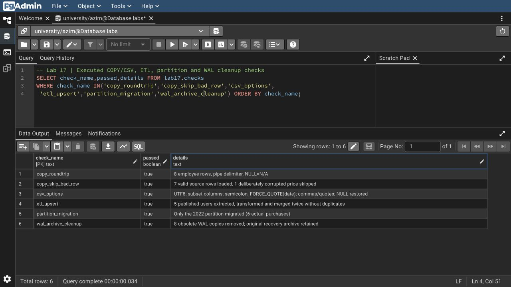
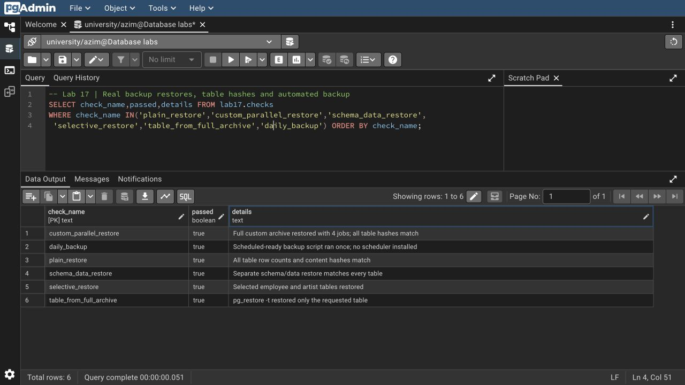
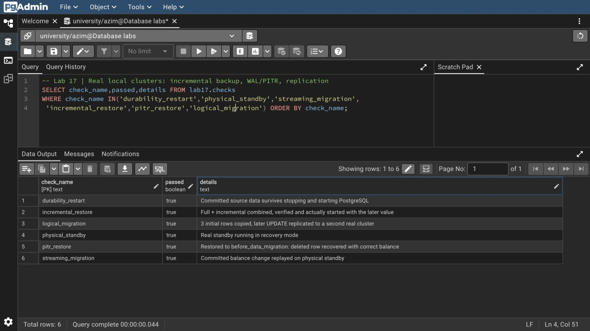
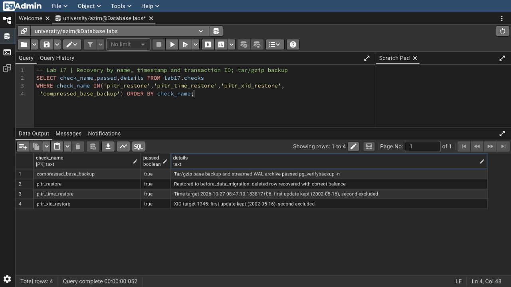

# Азим Маматбаев

## Лабораторная работа 17 — Data Import/Export and Backup

Я выполнил все разделы материала на настоящем PostgreSQL 18. Для восстановления и репликации создал отдельные локальные экземпляры с копиями учебных таблиц. Основной сервер не останавливал. После проверки отдельные серверы остановлены, а в `university.lab17` сохранены таблицы и результаты работы.

| Раздел материала | Что получилось |
| --- | --- |
| COPY и CSV | Экспорт/импорт 8 сотрудников и 7 покупок; выбор столбцов и запросов, UTF-8, `;` и `\|`, кавычки, даты, NULL |
| Ошибки импорта | В копии CSV намеренно испортил одно числовое поле: `ON_ERROR ignore` пропустил его и загрузил 7 допустимых строк |
| pg_dump / pg_restore | Plain/custom, выбранные таблицы, schema-only/data-only, исключение таблицы, переносимый дамп без владельцев |
| Полные копии | Дамп учебной базы и всего отдельного учебного кластера; роли экспортированы без паролей |
| Проверка восстановления | Plain, custom с 4 заданиями, раздельные schema/data и выборочное восстановление; количества и хеши содержимого таблиц совпали |
| Автоматизация | Скрипт резервирования выполнен один раз; активные копии хранятся 7 дней, устаревшие перемещаются в `expired/`; системное расписание не устанавливалось |
| WAL / base backup | Архивация WAL, plain и tar/gzip `pg_basebackup`, проверка `pg_verifybackup`; очистка устаревших сегментов выполнена на отдельной копии архива |
| Инкрементальная копия | Full + incremental объединены через `pg_combinebackup`, проверены и реально запущены с более поздними данными |
| PITR | Named restore point вернул удалённый счёт с остатком 3360.00; отдельно проверены `recovery_target_time` и `recovery_target_xid`: первое изменение даты сохранилось, второе исключено |
| Dump/restore migration | База восстановлена в новые базы и сверена по содержимому |
| Logical replication | Первые 3 строки и последующий `UPDATE` передались во второй экземпляр PostgreSQL |
| Physical replication | Работающий standby получил изменение через streaming replication |
| ETL и крупные таблицы | 5 исходных пользователей загружены через staging и дважды объединены без дублей; отдельно перенесена партиция 2022 года с 6 покупками |

Всего сохранено 22 успешные проверки. Данные и их ограничения описаны в [DATA.md](../week10/DATA.md). Конфигурации и команды из методички адаптированы к macOS и PostgreSQL 18: для WAL используется `-X stream`; параметры восстановления находятся в конфигурации, а `recovery.signal` служит отдельным пустым маркером. Параметр `-O` убирает владельцев, а не сохраняет их. Для остановки и запуска использован `pg_ctl` над отдельными каталогами.

[SQL COPY/ETL](lab17.sql) · [Сценарий выполнения](backup_lab.py) · [Скрипт резервирования](daily_backup.py) · [Очистка копии WAL](wal_cleanup.py) · [PITR по времени/XID](pitr_targets.py)

[Полный журнал команд](result.txt) · [Вывод COPY/ETL](copy-result.txt) · [Проверки JSON](verification.json) · [Все проверки](checks.txt) · [Журнал PITR](pitr-server.log) · [Очистка WAL](wal-cleanup-result.txt) · [Вывод PITR по времени/XID и tar/gzip](pitr-targets-result.txt)

[Custom backup](backups/coursework.dump) · [Plain backup](backups/coursework.sql) · [Содержимое архива](backup-contents.txt) · [Остальные копии и манифесты](backups/) · [SHA-256](SHA256SUMS) · [Запросы со скриншотов](screenshots.sql)

Физические каталоги PostgreSQL оставлены локально; в репозиторий загружены логические копии, [сжатая физическая копия отдельного учебного кластера](backups/physical-tar/), манифесты, журналы и скриншоты. Сценарии создания лабораторных рассчитаны на однократное выполнение в новых схемах и не удаляют существующие схемы при повторном запуске.

[Исходный материал из Drive](https://docs.google.com/document/d/1qLJkCgDSG3LaymACkhLxd_r6B5nqHRmU/edit)

Синтаксис проверен по официальным справочникам: [COPY](https://www.postgresql.org/docs/18/sql-copy.html), [pg_basebackup](https://www.postgresql.org/docs/18/app-pgbasebackup.html), [WAL и PITR](https://www.postgresql.org/docs/18/continuous-archiving.html), [logical replication](https://www.postgresql.org/docs/18/logical-replication-quick-setup.html).
