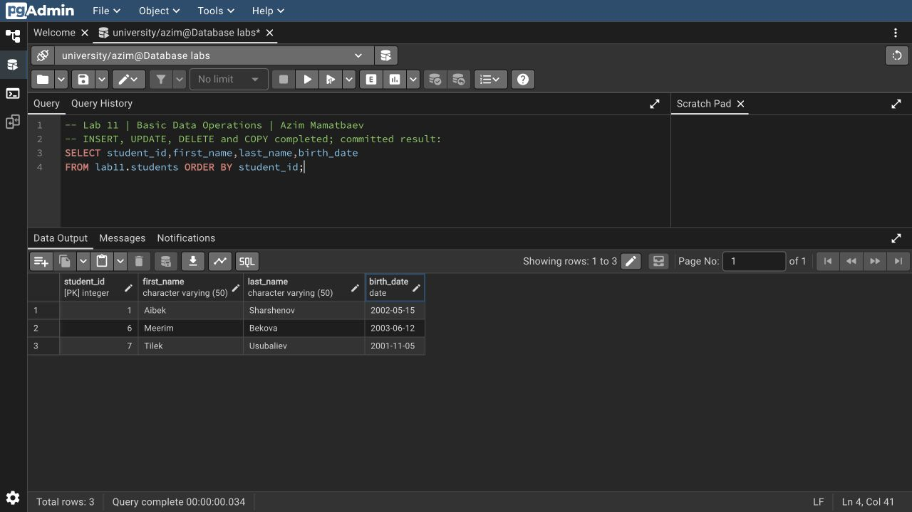

# Азим Маматбаев

## Лабораторная работа 11 — Basic Data Operations

Я создал `lab11.students` и выполнил операции из файла по порядку: одиночный и групповой `INSERT`, изменение даты рождения Aibek, два условных удаления, загрузку трёх строк через `COPY`, групповые `UPDATE` и `DELETE`. Имена, даты и CSV взяты из методички.

После `COMMIT` осталось три записи: Aibek Sharshenov (2002-05-15), Meerim Bekova и Tilek Usubaliev. Пропуски идентификаторов появились после удалений; новые номера не перенумеровывал.

[SQL](lab11.sql) · [CSV из задания](students.csv) · [Полный вывод выполнения](result.txt) · [Запрос со скриншота](screenshots.sql)

[Исходный материал из Drive](https://docs.google.com/document/d/1RVpvu9cB8a5DvNdprKtkErKihBPt3OMs/edit)
